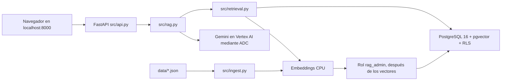
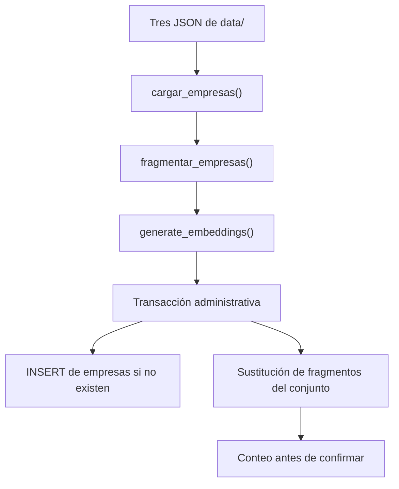
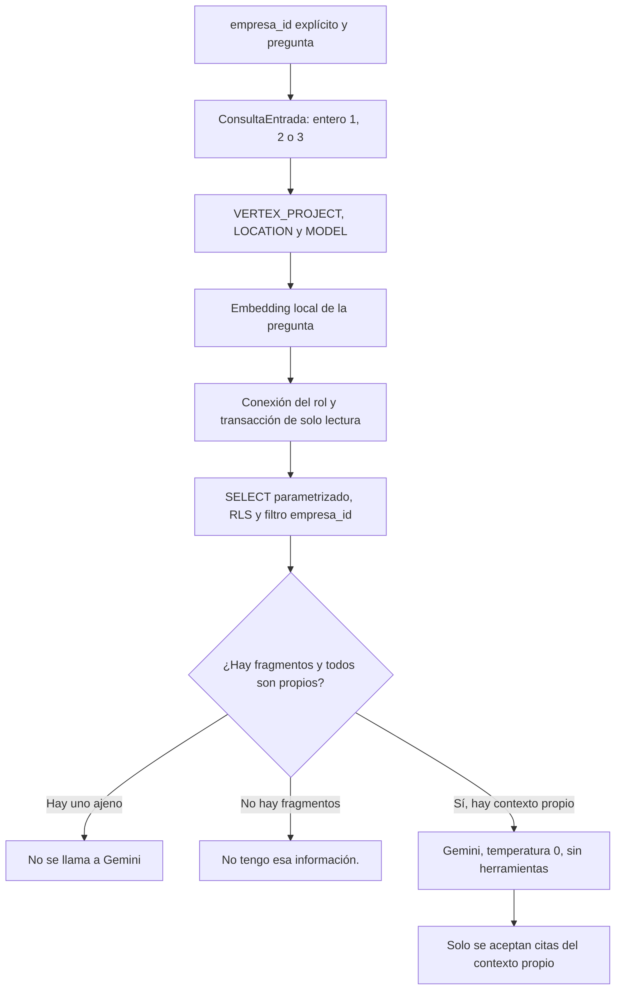
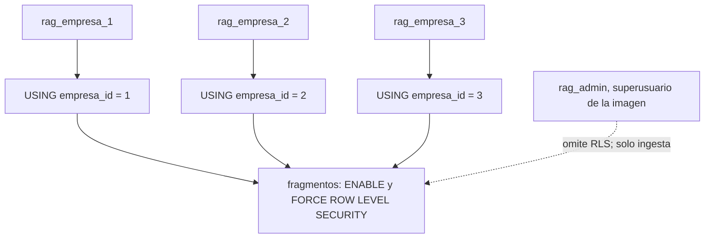
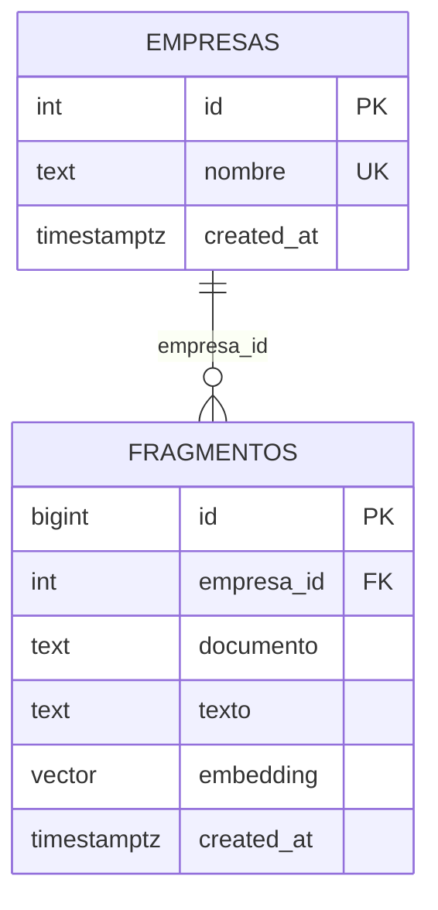
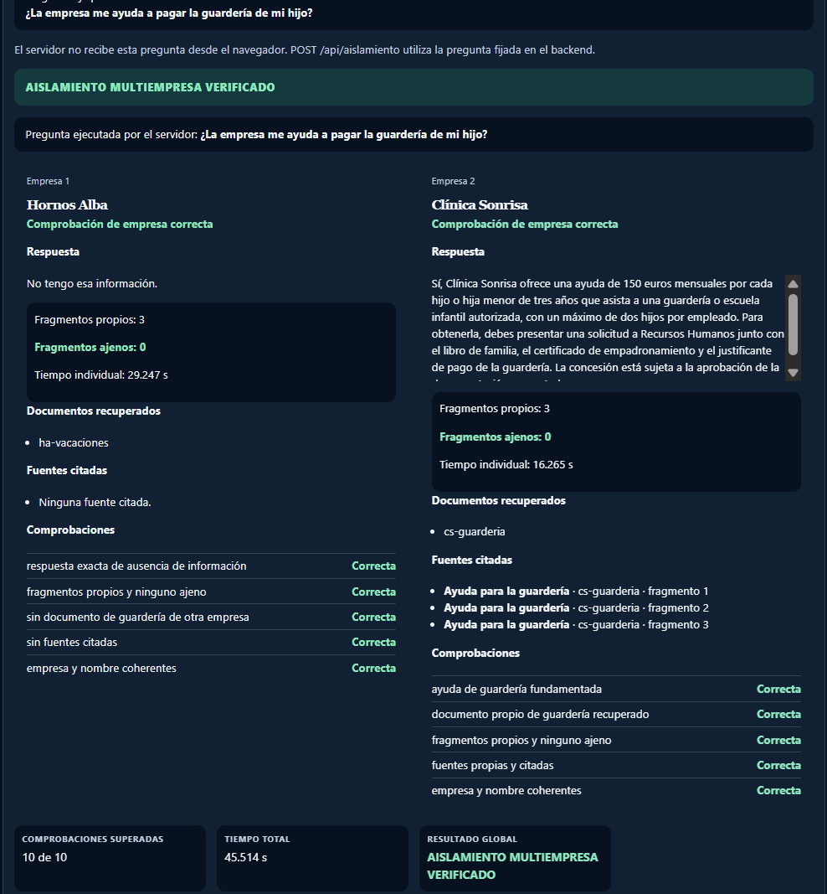

# Enterprise RAG — Asistente documental multiempresa

Sistema RAG seguro con PostgreSQL, pgvector, Row-Level Security y Gemini.

Demostración académica del Máster AI Engineer de ThePower. Una misma base atiende a tres empresas ficticias y cada consulta solo puede recuperar la documentación de la empresa indicada de forma explícita.

Las etiquetas siguientes resumen versiones fijadas en el repositorio o el resultado local ya ejecutado. No son estados de un flujo de integración continua.


## Descripción del proyecto

Una organización que presta el mismo asistente a varios clientes no puede mezclar sus políticas internas. El problema que resuelve esta práctica es ese: responder preguntas sobre documentación propia sin que una empresa obtenga fragmentos de otra, aunque compartan base de datos, modelo de embeddings y modelo de lenguaje.

Los objetivos son indexar un corpus ficticio multiempresa, recuperar contexto por similitud vectorial, generar la respuesta solo con ese contexto y demostrar el aislamiento tanto en PostgreSQL como en la aplicación.

RAG (*Retrieval-Augmented Generation*) separa dos pasos. Primero se recuperan los fragmentos más próximos a la pregunta. Después un modelo de lenguaje redacta la respuesta usando únicamente esos fragmentos. La recuperación no redacta la política; la generación no busca en toda la base ni en la web.

pgvector añade a PostgreSQL el tipo `vector` y el operador de distancia coseno `<=>`. Aquí cada fragmento se guarda como `VECTOR(384)`, la dimensión del modelo local `paraphrase-multilingual-MiniLM-L12-v2`.

El aislamiento es necesario porque el identificador de empresa no puede deducirse de la pregunta ni de la respuesta del modelo. Una pregunta sobre guardería no autoriza a leer la política de otra empresa. Por eso cada empresa tiene su propio rol de PostgreSQL, Row-Level Security obliga el filtro aunque la consulta SQL no lo escriba, y la recuperación añade además un `WHERE empresa_id = %s` parametrizado.

## Cumplimiento del enunciado

| Requisito | Cómo se cumple | Evidencia |
| --- | --- | --- |
| 1. Crear PostgreSQL y activar pgvector | Servicio `postgres` con la imagen `pgvector/pgvector:pg16`. La extensión se crea con `CREATE EXTENSION IF NOT EXISTS vector`. | [docker-compose.yml](docker-compose.yml), [sql/01_extensions.sql](sql/01_extensions.sql) |
| 2. Crear una tabla con texto, embedding y empresa_id | `fragmentos` guarda `texto`, `embedding VECTOR(384)` y `empresa_id`, con clave foránea a `empresas`. | [sql/02_schema.sql](sql/02_schema.sql) |
| 3. Tres empresas, tres documentos cada una, fragmentados y vectorizados | Tres JSON en `data/`. La ingesta administrativa produce 36 fragmentos, 12 por empresa, de 384 dimensiones. | [data/](data/), [src/chunking.py](src/chunking.py), [src/embeddings.py](src/embeddings.py), [src/ingest.py](src/ingest.py) |
| 4. Búsqueda vectorial restringida por empresa e integración con un LLM | `buscar()` usa el rol de la empresa, filtra por `empresa_id` y ordena por distancia coseno. `responder()` envía solo esos fragmentos a Gemini en Vertex AI. | [src/retrieval.py](src/retrieval.py), [src/rag.py](src/rag.py) |
| 5. Demostrar que una empresa no puede recuperar información de otra | Políticas RLS, pruebas de seguridad y recuperación, demostración de terminal y laboratorio web. La evidencia registrada termina con cero fragmentos ajenos y 10/10 comprobaciones. | [sql/03_security.sql](sql/03_security.sql), [src/demo_aislamiento.py](src/demo_aislamiento.py), [evidencias/05_aislamiento_multiempresa.png](evidencias/05_aislamiento_multiempresa.png) |

## Arquitectura

La aplicación escucha solo en `127.0.0.1`. La ingesta usa el rol administrador. Las consultas de una empresa no pueden abrir esa conexión si falla la suya.



La ingesta no llama a Gemini. Calcula los vectores antes de abrir la transacción y solo entonces escribe con el administrador.



Una consulta válida no cambia de empresa si la recuperación o la generación fallan.



El aislamiento no depende de una variable de sesión que el cliente pueda cambiar. Cada política nombra un único rol.



No hay índice HNSW ni IVFFlat. Con 36 fragmentos la búsqueda es exacta, ordenada por `embedding <=> %s` y, en empate, por `id`.



La columna `documento` no tiene un campo separado para el título. La ingesta guarda un valor reversible con el separador `\x1f`: identificador, número de fragmento y título.

## Stack tecnológico

La ejecución real verificó Python 3.14.4, PostgreSQL 16.16 y pgvector 0.8.7. La imagen de [docker-compose.yml](docker-compose.yml) es `pgvector/pgvector:pg16`; no fija de forma inmutable esas versiones menores. Python tampoco está fijado como paquete. [sql/01_extensions.sql](sql/01_extensions.sql) consulta `extversion` al activar la extensión. El resto de versiones de biblioteca procede de [requirements.txt](requirements.txt).

| Tecnología | Versión o identificador verificable | Uso |
| --- | --- | --- |
| Python | 3.14.4, versión realmente verificada | Aplicación y pruebas. No se ha comprobado otra versión. |
| PostgreSQL | 16.16 verificado; imagen `pgvector/pgvector:pg16` | Base `rag_multitenant`. La versión menor no está fijada en la imagen. |
| pgvector | 0.8.7 verificado; extensión `vector` de esa imagen | Tipo `VECTOR(384)` y distancia coseno. La versión menor no está fijada en SQL. |
| Docker Compose | Servicio `postgres`, contenedor `rag-pgvector-db` | PostgreSQL local en `127.0.0.1:5433` |
| psycopg | `psycopg[binary]==3.3.9` | Conexiones y consultas parametrizadas |
| pgvector para Python | `pgvector==0.5.1` | Adaptación del tipo `vector` |
| Sentence Transformers | `sentence-transformers==6.3.0` | Embeddings locales |
| PyTorch | `torch==2.15.0+cpu` | Inferencia solo en CPU; el índice extra evita wheels CUDA |
| Modelo de embeddings | `sentence-transformers/paraphrase-multilingual-MiniLM-L12-v2` | 384 dimensiones, normalización L2 |
| NumPy | `numpy==2.4.2` | Matrices `float32` |
| python-dotenv | `python-dotenv==1.2.4` | Carga de `.env` sin imprimirlo |
| google-genai | `google-genai==3.6.1` | Cliente Vertex AI; no se envía una clave en el código |
| Gemini | Identificador configurado en `VERTEX_MODEL` | Generación. El ejemplo del repositorio usa `gemini-3.1-flash-lite` |
| FastAPI | `fastapi==0.165.0` | API local |
| Uvicorn | `uvicorn==0.54.0` | Servidor ASGI en `127.0.0.1:8000` |
| Frontend | HTML5, CSS3 y JavaScript nativo | Sin frameworks ni CDN de la aplicación |
| pytest | `pytest==9.2.0` | 185 pruebas superadas en una ejecución local |
| httpx2 | `httpx2==2.16.2` | Cliente que Starlette 1.10 usa en `TestClient` |

No se usan LangChain ni LlamaIndex. El flujo RAG está implementado en Python.

## Empresas y documentación

Los nueve documentos son ficticios y se redactaron solo para esta práctica. No contienen datos personales reales. La ayuda de guardería aparece únicamente en Clínica Sonrisa. Hornos Alba y Ruta Norte no mencionan esa prestación, ni siquiera para decir que no existe.

| Empresa | ID | Rol PostgreSQL | Documento | Identificador |
| --- | --- | --- | --- | --- |
| Hornos Alba | 1 | `rag_empresa_1` | Política de vacaciones: veintitrés días laborables | `ha-vacaciones` |
| Hornos Alba | 1 | `rag_empresa_1` | Turnos y horarios | `ha-turnos` |
| Hornos Alba | 1 | `rag_empresa_1` | Seguridad alimentaria | `ha-seguridad-alimentaria` |
| Clínica Sonrisa | 2 | `rag_empresa_2` | Política de vacaciones: veintidós días laborables y dos de libre disposición | `cs-vacaciones` |
| Clínica Sonrisa | 2 | `rag_empresa_2` | Ayuda para la guardería: ciento cincuenta euros mensuales por hijo menor de tres años, con solicitud y justificación | `cs-guarderia` |
| Clínica Sonrisa | 2 | `rag_empresa_2` | Formación de empleados | `cs-formacion` |
| Ruta Norte | 3 | `rag_empresa_3` | Política de vacaciones: veinticinco días laborables | `rn-vacaciones` |
| Ruta Norte | 3 | `rag_empresa_3` | Dietas y kilometraje | `rn-dietas` |
| Ruta Norte | 3 | `rag_empresa_3` | Teletrabajo | `rn-teletrabajo` |

La fragmentación divide cada documento por párrafos y solo subdivide un párrafo si no cabe en la ventana del modelo. La ingesta verificada dejó 36 fragmentos: 12 por empresa. Cada embedding tiene 384 dimensiones, tipo `float32` y norma L2 1.

## Seguridad y aislamiento

Cada empresa inicia sesión con un rol distinto: `rag_empresa_1`, `rag_empresa_2` y `rag_empresa_3`. Esos roles son `LOGIN`, no superusuario, sin `CREATEDB`, `CREATEROLE`, `REPLICATION` ni `BYPASSRLS`, y con `NOINHERIT`. No son miembros unos de otros ni de `rag_admin`, así que no pueden usar `SET ROLE` para adoptar otro rol.

`ENABLE ROW LEVEL SECURITY` activa las políticas de `fragmentos`. `FORCE ROW LEVEL SECURITY` las aplica también al propietario de la tabla cuando ese propietario no es superusuario. Hay tres políticas `PERMISSIVE`, solo `FOR SELECT`, cada una dirigida a un único rol y con una condición constante: `empresa_id = 1`, `2` o `3`. No dependen de `current_setting()`.

RLS no protege frente a un superusuario ni frente a un rol con `BYPASSRLS`: PostgreSQL les permite omitir las políticas. En la imagen oficial, el usuario definido por `POSTGRES_USER` es superusuario. Por eso `rag_admin` puede ingerir todas las empresas y no debe usarse para responder consultas. La aplicación no abre la conexión administrativa como alternativa si falla la de una empresa.

Además de RLS, `buscar()` exige que `current_user` sea el rol esperado y añade `WHERE empresa_id = %s`. La pregunta, el vector y el límite viajan como parámetros; no se concatenan al SQL. Los roles de empresa solo tienen `CONNECT`, `USAGE` sobre `public` y `SELECT` sobre `fragmentos`. No tienen `INSERT`, `UPDATE`, `DELETE`, `TRUNCATE` ni `CREATE` en el esquema. La comprobación de salud ejecuta `SET TRANSACTION READ ONLY` con esos roles.

La ingesta administrativa y la recuperación están separadas: `conexion_admin()` solo la usa la ingesta y la prueba de conexiones; `conexion_empresa()` la usan la búsqueda, el RAG y la salud.

`POST /api/consulta` rechaza el tipo original de `empresa_id` antes de cualquier conversión. Solo acepta los enteros 1, 2 y 3. Rechaza booleanos, números decimales, cadenas, nulos, identificadores inexistentes, preguntas vacías y campos adicionales. Si un fragmento o una fuente pertenecen a otra empresa, la API responde con error y no serializa el contenido.

Las credenciales viven en `.env`, excluido por [.gitignore](.gitignore). Las representaciones de configuración ocultan la contraseña. Las respuestas HTTP de error no devuelven trazas ni secretos. [sql/03_security.sql](sql/03_security.sql) crea los roles sin contraseña; las contraseñas se configuran fuera del archivo versionado.

El middleware HTTP admite solo `127.0.0.1`, `::1`, `localhost` y el cliente de pruebas `testclient`. No hay `CORSMiddleware`. Uvicorn se arranca en `127.0.0.1`, no en `0.0.0.0`.

El selector de empresa de la interfaz es una función de demostración local. No autentica al usuario ni sustituye a una identidad de servidor. En producción, `empresa_id` debe determinarse en el servidor mediante autenticación y autorización, nunca a partir del formulario, de la pregunta o de la respuesta del modelo.

## Estructura del repositorio

```text
thepower-rag-pgvector/
├── .env.example
├── .gitignore
├── docker-compose.yml
├── README.md
├── requirements.txt
├── data/
│   ├── clinica_sonrisa.json
│   ├── hornos_alba.json
│   └── ruta_norte.json
├── evidencias/
│   └── 05_aislamiento_multiempresa.png
├── frontend/
│   ├── index.html
│   ├── styles.css
│   └── app.js
├── sql/
│   ├── 01_extensions.sql
│   ├── 02_schema.sql
│   └── 03_security.sql
├── src/
│   ├── __init__.py
│   ├── api.py
│   ├── chunking.py
│   ├── config.py
│   ├── database.py
│   ├── demo_aislamiento.py
│   ├── embeddings.py
│   ├── ingest.py
│   ├── rag.py
│   └── retrieval.py
└── tests/
    ├── test_api.py
    ├── test_rag.py
    ├── test_retrieval.py
    └── test_security.py
```

No se versionan `.env`, `.venv/`, cachés de Python ni volcados de PostgreSQL.

| Archivo | Función |
| --- | --- |
| [src/config.py](src/config.py) | Separa la configuración administrativa de la de cada empresa y no imprime secretos. |
| [src/database.py](src/database.py) | Abre conexiones independientes y registra el tipo `vector`. |
| [src/chunking.py](src/chunking.py) | Valida los JSON y fragmenta por párrafos. No calcula embeddings. |
| [src/embeddings.py](src/embeddings.py) | Carga el modelo en CPU y normaliza vectores de 384 dimensiones. |
| [src/ingest.py](src/ingest.py) | Ingesta idempotente con el rol administrador. |
| [src/retrieval.py](src/retrieval.py) | Búsqueda vectorial de solo lectura, restringida a una empresa. |
| [src/rag.py](src/rag.py) | Orquesta recuperación y Gemini. Temperatura 0, sin herramientas ni búsqueda web. |
| [src/demo_aislamiento.py](src/demo_aislamiento.py) | Dos consultas reales con la misma pregunta de guardería. |
| [src/api.py](src/api.py) | API local, middleware de clientes locales y estáticos del frontend. |
| [frontend/](frontend/) | Interfaz Enterprise RAG, servida por la misma aplicación. |

## Instalación y configuración

El entorno en el que se validó el ejercicio fue WSL2, con Python 3.14.4, Docker, Docker Compose y el entorno virtual `.venv` del proyecto. No se ha comprobado el funcionamiento con otras versiones de Python. Los comandos siguientes son los de esa implementación. Hace falta Docker y Docker Compose. Para los scripts SQL hace falta `psql`, en el host o dentro del contenedor. Para las consultas reales a Gemini hace falta Google Cloud CLI y un proyecto propio con Vertex AI autorizado.

El remoto conocido es `git@github.com:jatrz/thepower-rag-pgvector.git`. La rama actual del árbol de trabajo es `feat/multitenant-rag`; estas instrucciones no cambian de rama. Un clon solo reproduce la práctica completa cuando esta versión ya está publicada en esa rama.

```bash
git clone -b feat/multitenant-rag git@github.com:jatrz/thepower-rag-pgvector.git
cd thepower-rag-pgvector
python3 -m venv .venv
source .venv/bin/activate
python -m pip install -r requirements.txt
cp .env.example .env
```

`requirements.txt` declara `--extra-index-url https://download.pytorch.org/whl/cpu` y `torch==2.15.0+cpu`. No debe instalarse el wheel CUDA de PyPI. No hace falta un comando adicional de PyTorch si la instalación usa ese archivo.

Editar `.env` y sustituir todos los marcadores. No se documentan aquí contraseñas, tokens ni credenciales. Las variables que la implementación lee son:

- Administración de Docker y migraciones: `POSTGRES_USER`, `POSTGRES_PASSWORD`, `POSTGRES_DB`, `POSTGRES_HOST`, `POSTGRES_PORT`. El usuario previsto es `rag_admin`, la base `rag_multitenant`, el host `127.0.0.1` y el puerto del host `5433`.
- Conexión de las empresas: `APP_DB_NAME`, `APP_DB_HOST`, `APP_DB_PORT` y, para cada empresa, `RAG_EMPRESA_N_USER`, `RAG_EMPRESA_N_PASSWORD`, `RAG_EMPRESA_N_ID` y `RAG_EMPRESA_N_NAME`.
- Vertex AI: `VERTEX_PROJECT`, `VERTEX_LOCATION` y `VERTEX_MODEL`.

Esas son todas las variables de [.env.example](.env.example). El modelo de embeddings y sus 384 dimensiones no se configuran ahí: [src/embeddings.py](src/embeddings.py) define `MODEL_NAME` como `sentence-transformers/paraphrase-multilingual-MiniLM-L12-v2` y `EMBEDDING_DIM` como 384.

La generación usa Application Default Credentials y `VERTEX_PROJECT`, `VERTEX_LOCATION` y `VERTEX_MODEL`. No usa una clave de API. Cada persona debe indicar su propio proyecto autorizado. No se debe reutilizar un proyecto privado ajeno. El modelo debe ser un identificador de modelo publicador, no una ruta de modelo ajustado: el código rechaza valores con `/`, `tuned` o que empiecen por `projects`. `.env.example` deja `VERTEX_PROJECT` como marcador sustituible.

Arrancar PostgreSQL:

```bash
docker compose up -d
docker compose ps
```

El contenedor publica PostgreSQL solo en `127.0.0.1:5433`. Dentro escucha en 5432. Los datos persisten en el volumen `pgdata`. El healthcheck usa `pg_isready`. El contenedor solo recibe las variables administrativas.

Cuando el servicio esté listo, ejecutar los scripts en orden con `psql`. [sql/03_security.sql](sql/03_security.sql) usa metaórdenes de `psql` (`\set` y `\gexec`), así que no debe lanzarse con un cliente que no sea `psql`.

```bash
psql -h 127.0.0.1 -p 5433 -U rag_admin -d rag_multitenant -v ON_ERROR_STOP=1 -f sql/01_extensions.sql
psql -h 127.0.0.1 -p 5433 -U rag_admin -d rag_multitenant -v ON_ERROR_STOP=1 -f sql/02_schema.sql
psql -h 127.0.0.1 -p 5433 -U rag_admin -d rag_multitenant -v ON_ERROR_STOP=1 -f sql/03_security.sql
```

Si `psql` no está instalado en el host, el cliente del contenedor puede leer cada script por la entrada estándar:

```bash
docker compose exec -T postgres psql -U rag_admin -d rag_multitenant -v ON_ERROR_STOP=1 -f - < sql/01_extensions.sql
docker compose exec -T postgres psql -U rag_admin -d rag_multitenant -v ON_ERROR_STOP=1 -f - < sql/02_schema.sql
docker compose exec -T postgres psql -U rag_admin -d rag_multitenant -v ON_ERROR_STOP=1 -f - < sql/03_security.sql
```

Los roles de empresa se crean sin contraseña. Configurarlas en una sesión interactiva, fuera de cualquier archivo versionado, y copiar esos mismos valores a `RAG_EMPRESA_1_PASSWORD`, `RAG_EMPRESA_2_PASSWORD` y `RAG_EMPRESA_3_PASSWORD`:

```text
docker compose exec -it postgres psql -U rag_admin -d rag_multitenant
\password rag_empresa_1
\password rag_empresa_2
\password rag_empresa_3
```

Para Gemini, habilitar Vertex AI en un proyecto propio y crear credenciales locales de aplicación. No se copian archivos de credenciales al repositorio:

```bash
gcloud auth application-default login
gcloud config set project IDENTIFICADOR_DEL_PROYECTO_PROPIO
```

`VERTEX_PROJECT` debe ser ese identificador. `VERTEX_LOCATION` debe ser una región autorizada para el modelo elegido.

Ingesta y comprobación de conexiones:

```bash
python -m src.ingest
python -m src.database
```

`python -m src.database` prueba el administrador y los tres roles, comprueba `current_user` y que el tipo `vector` quedó registrado. No modifica datos.

## Ejecución

Generar un embedding de prueba, sin escribir en PostgreSQL:

```bash
python -m src.embeddings
```

Fragmentar los JSON y mostrar el resumen, sin embeddings ni base de datos:

```bash
python -m src.chunking
```

Ingerir el corpus. Este comando sí genera los 36 embeddings y los persiste:

```bash
python -m src.ingest
```

La ingesta es idempotente: una segunda ejecución sustituye los fragmentos del conjunto dentro de una transacción y no debe dejar duplicados. No borra la tabla completa.

Recuperación vectorial de las cinco búsquedas de demostración, sin Gemini:

```bash
python -m src.retrieval
```

Las cinco preguntas están fijadas en el código: vacaciones para las tres empresas y guardería para Hornos Alba y Clínica Sonrisa. El identificador no se extrae del texto.

Consultas RAG reales. Requieren ADC, Vertex AI y los fragmentos ya ingeridos:

```bash
python -m src.rag
```

Demostración de aislamiento en terminal, con la misma pregunta para las empresas 1 y 2:

```bash
python -m src.demo_aislamiento
```

Aplicación web:

```bash
python -m uvicorn src.api:app --host 127.0.0.1 --port 8000
```

- Aplicación: http://localhost:8000/
- Swagger: http://localhost:8000/docs

`python -m src.api` arranca el mismo host y puerto, con el registro de acceso desactivado. No usar `0.0.0.0`. La primera consulta puede tardar más si el modelo de embeddings todavía no está en caché. Las llamadas a Gemini observadas en la demostración tardaron del orden de decenas de segundos.

## API REST

Los cuatro endpoints están implementados en [src/api.py](src/api.py). Los JSON de esta sección muestran el contrato. No son una transcripción de una respuesta concreta de Gemini, salvo la remisión a la demostración registrada del apartado siguiente.

### GET /api/health

Comprueba PostgreSQL con los tres roles de empresa. No llama a Gemini y devuelve `gemini_comprobado: false` aunque la base esté disponible.

Ejemplo de contrato cuando las tres conexiones son correctas:

```json
{
  "estado": "ok",
  "postgresql": {
    "conectado": true,
    "modo": "roles_de_empresa",
    "administrador": false,
    "empresas_comprobadas": [1, 2, 3]
  },
  "tecnologias": ["PostgreSQL", "pgvector", "RLS", "Gemini"],
  "gemini_comprobado": false,
  "aviso": "Gemini figura como tecnología del sistema, pero este endpoint no lo comprueba."
}
```

Si la comprobación falla, el estado HTTP es 503, `estado` vale `no_disponible` y el aviso no incluye credenciales.

### GET /api/empresas

No consulta PostgreSQL. Devuelve los identificadores y nombres de la configuración, sin roles ni contraseñas.

```json
{
  "empresas": [
    {"id": 1, "nombre": "Hornos Alba"},
    {"id": 2, "nombre": "Clínica Sonrisa"},
    {"id": 3, "nombre": "Ruta Norte"}
  ],
  "aviso": "El selector de empresa es una función de demostración local. No autentica al usuario ni sustituye a una identidad de servidor."
}
```

### POST /api/consulta

Petición de ejemplo:

```json
{
  "empresa_id": 1,
  "pregunta": "¿Cuántos días de vacaciones tengo?"
}
```

`empresa_id` debe ser el número JSON `1`, `2` o `3`, no una cadena ni un booleano. La pregunta se recorta, no puede estar vacía y admite como máximo 240 caracteres.

La respuesta contiene `empresa_id`, `nombre_empresa`, `pregunta`, `respuesta`, `documentos_recuperados`, `fragmentos_propios`, `fragmentos_ajenos`, `similitudes`, `fragmentos`, `fuentes` y `duracion_s`. Las similitudes son distancias coseno transformadas en similitud y redondeadas a seis decimales. No son probabilidades ni la confianza del modelo. Una entrada inválida devuelve 422 y no llama a `responder()`.

### POST /api/aislamiento

No recibe la pregunta desde el cliente. Ejecuta en el servidor, para las empresas 1 y 2, la pregunta fija:

```text
¿La empresa me ayuda a pagar la guardería de mi hijo?
```

El cuerpo puede omitirse. La respuesta incluye `pregunta`, `empresas`, `duracion_s`, `aislamiento_verificado` y `resultado_global`. Cada empresa aporta su respuesta, documentos, recuentos, fuentes, cinco comprobaciones, duración y `correcta`. El resultado global solo es `AISLAMIENTO MULTIEMPRESA VERIFICADO` si las dos empresas superan todas sus comprobaciones. El resultado registrado de esa prueba está en el apartado siguiente, no en este ejemplo de contrato.

## Interfaz web

Enterprise RAG se sirve en `/` desde [frontend/](frontend/). Swagger permanece en `/docs`.

- El modo oscuro es el predeterminado. El modo claro se selecciona en la cabecera y solo esa preferencia se guarda en `localStorage`, con la clave `enterprise-rag-theme`.
- El selector muestra Hornos Alba, Clínica Sonrisa y Ruta Norte obtenidos de `GET /api/empresas`, con el aviso de que no es autenticación.
- El asistente envía `POST /api/consulta`. Hay preguntas sugeridas de vacaciones, guardería y teletrabajo.
- La respuesta muestra el texto de Gemini, la duración real, fragmentos propios y ajenos, documentos recuperados y fuentes citadas.
- Los fragmentos completos están en secciones desplegables. La similitud coseno se muestra como número y como barra, con una nota de que no es probabilidad ni confianza.
- Un cronómetro cuenta el tiempo de espera. No hay una barra de progreso ficticia. Los botones se desactivan mientras hay una petición.
- Se puede copiar la respuesta y limpiar el resultado. Las consultas no se guardan en el navegador.
- El laboratorio de aislamiento llama a `POST /api/aislamiento` y permanece pendiente hasta ejecutarlo. El botón de impresión usa `window.print()` con estilos específicos para esa sección.
- El indicador de empresas sale de la API. Los indicadores de documentos, fragmentos y pruebas son textos fijos de la carga inicial; no se recalculan al abrir la página. El de pruebas muestra 185, la cifra previamente verificada, y no vuelve a ejecutar la suite.

## Demostración de aislamiento

Pregunta real, ejecutada por el servidor y no tomada del texto del navegador:

```text
¿La empresa me ayuda a pagar la guardería de mi hijo?
```

Resultado registrado en [evidencias/05_aislamiento_multiempresa.png](evidencias/05_aislamiento_multiempresa.png):

| Comprobación | Hornos Alba | Clínica Sonrisa |
| --- | --- | --- |
| Respuesta | No tengo esa información. | Ayuda de 150 euros mensuales por cada hijo menor de tres años que cumpla los requisitos establecidos. La captura incluye además el máximo de dos hijos, la solicitud y la documentación exigida. |
| Fragmentos propios | 3 | 3 |
| Fragmentos ajenos | 0 | 0 |
| Documentos recuperados | `ha-vacaciones` | `cs-guarderia` |
| Fuentes citadas | 0 | 3: `cs-guarderia`, fragmentos 1, 2 y 3 |
| Comprobaciones | 5/5 | 5/5 |
| Tiempo individual registrado | 29,247 s | 16,265 s |

El total registrado es 10/10 comprobaciones y 45,514 s. El resultado global visible es `AISLAMIENTO MULTIEMPRESA VERIFICADO`.



## Pruebas automatizadas

Resultado real de una única ejecución: 185 pruebas superadas. No hay una medición de cobertura de código en el repositorio; no se afirma ningún porcentaje.

```bash
python -m pytest tests/ -v --tb=short
```

| Suite | Qué comprueba |
| --- | --- |
| [tests/test_security.py](tests/test_security.py) | Integración con la base local. Cada rol ve exactamente sus 12 fragmentos, no ve documentos ajenos aunque no haya `WHERE`, no es superusuario, no omite RLS, no adopta otro rol y no puede escribir. No usa el administrador. |
| [tests/test_retrieval.py](tests/test_retrieval.py) | Integración de la búsqueda vectorial. No llama a Gemini. Comprueba vacaciones de cada empresa, que Hornos Alba no recupera la guardería y que Clínica Sonrisa sí recupera la suya. |
| [tests/test_rag.py](tests/test_rag.py) | El contexto enviado pertenece a la empresa. La recuperación de las pruebas de contexto usa la base local. Gemini se simula: ninguna prueba construye el cliente real ni abre la conexión administrativa. |
| [tests/test_api.py](tests/test_api.py) | Contrato HTTP con `TestClient` y mocks. No necesita PostgreSQL, embeddings ni Gemini. Cubre los cuatro endpoints, el rechazo de entradas, el bloqueo de contenido ajeno, el frontend, la documentación, el middleware local y la ausencia de CORS permisivo. |

Las pruebas de seguridad y recuperación necesitan la base ingerida y las contraseñas de los roles de empresa. Las de API no. `TestClient` usa `httpx2==2.16.2`, declarado en `requirements.txt`. Starlette 1.10 lo admite en su extra `full` como `httpx2>=2.0.0` y lo resuelve antes que `httpx`. Al instalarlo, pip también trae su dependencia `httpcore2==2.16.2`; esa versión no se fija aparte.

## Limitaciones y evolución futura

Esto es una demostración local. No hay autenticación ni autorización de usuarios: elegir una empresa en el navegador no demuestra identidad. En producción esa decisión debe tomarla el servidor.

Las consultas reales dependen de Vertex AI, de ADC y de la disponibilidad del modelo configurado. La latencia de Gemini es variable; en la evidencia de aislamiento los tiempos individuales fueron 29,247 s y 16,265 s. Un fallo de generación no se completa con una respuesta inventada.

El corpus tiene nueve documentos y 36 fragmentos. No representa el volumen ni la ambigüedad de un archivo empresarial real. La búsqueda exacta es adecuada para este tamaño; no hay índice aproximado.

Las fuentes citadas indican qué fragmentos del contexto recuperado usó el modelo. No garantizan por sí solas que la redacción sea absolutamente exacta ni que el modelo no haya omitido una condición del fragmento. La respuesta debe leerse junto con las fuentes.

Mejoras no implementadas: autenticación y autorización de servidor, observabilidad, índices vectoriales para volúmenes grandes y un despliegue que no quede limitado a localhost. No forman parte del sistema actual.

## Conclusiones

La práctica cumple los cinco requisitos: PostgreSQL con pgvector, fragmentos asociados a una empresa, tres empresas con tres documentos vectorizados, búsqueda restringida integrada con Gemini y una demostración en la que Hornos Alba no obtiene la ayuda de guardería de Clínica Sonrisa.

El aislamiento no queda solo en un filtro de la aplicación. Está en roles separados, políticas RLS forzadas, privilegios de solo lectura, consultas parametrizadas y la negativa a devolver fragmentos o fuentes de otra empresa. Las 185 pruebas y la captura del laboratorio web documentan ese resultado en el entorno local del ejercicio.
